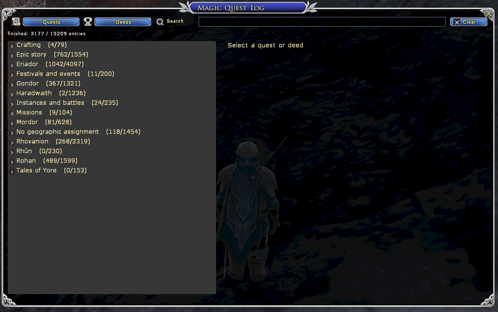
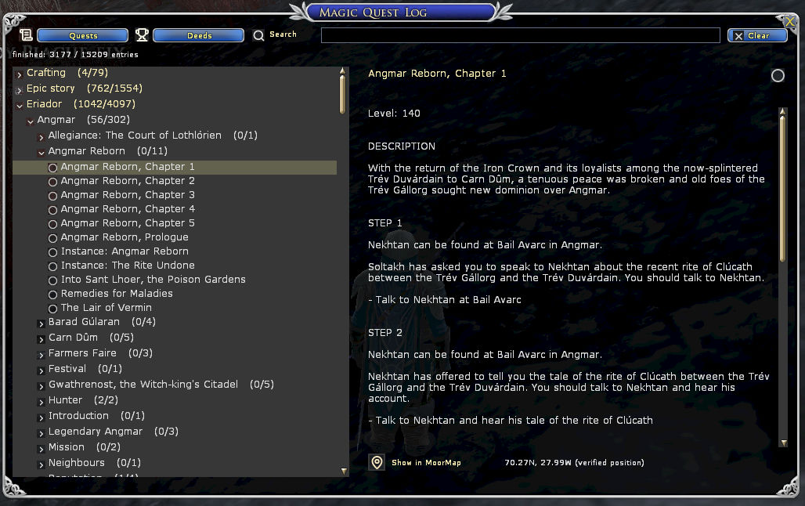
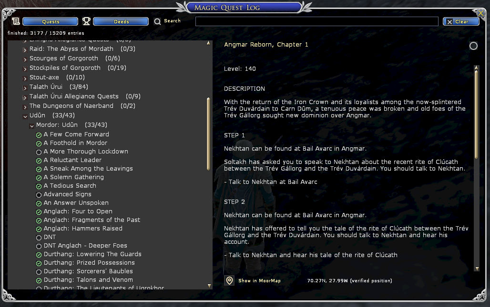
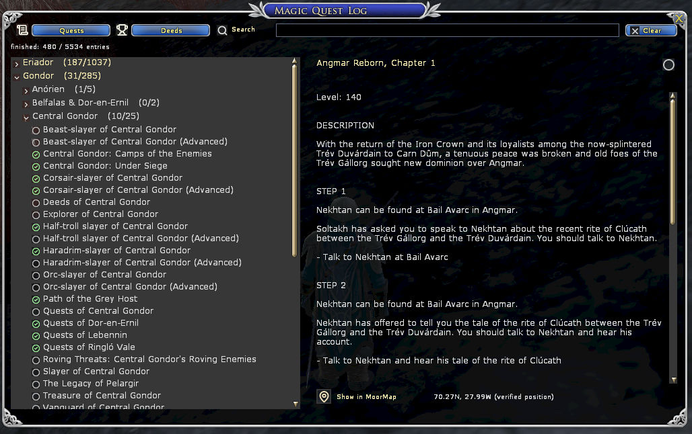
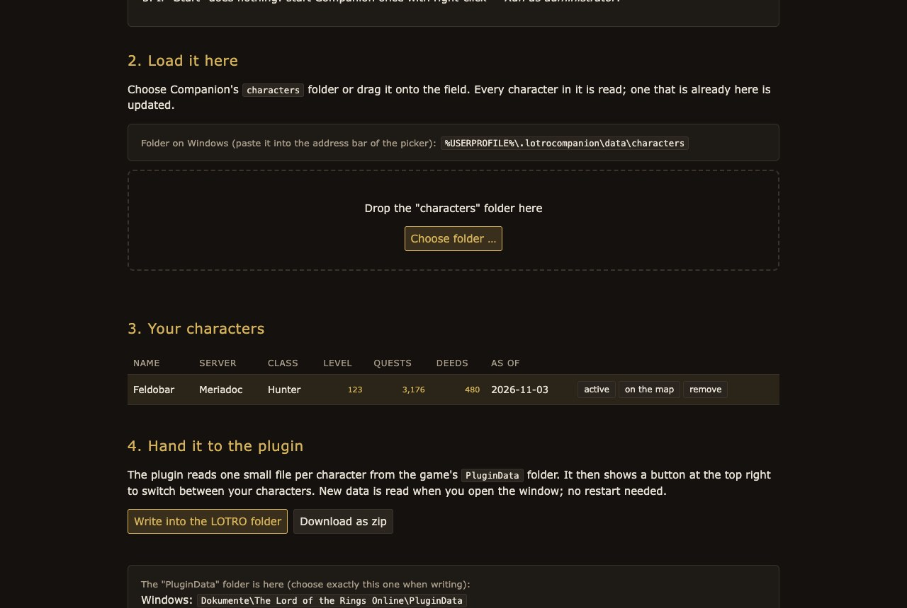
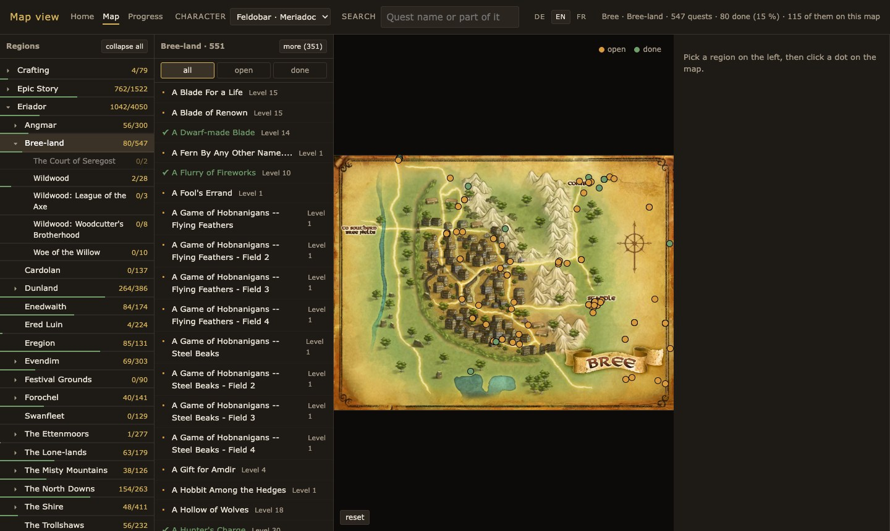

# Magic Quest Log

A standalone LOTRO plugin for quests and deeds. The catalog covers German,
English and French; the plugin follows the client language and falls back to
English.

The repository contains the plugin, the tools and the icons. The generated
catalog (~102 MB) is **not** in the repository — it ships as a release archive.
Your progress never enters it: it lives in the game's own `PluginData` folder.

**Companion site:** the same quests as a map, with your progress, at
<https://llb.sirhexalot.de/> ([source](https://github.com/Sirhexalot/lotro-log-book)).
Its **Progress** page also brings your older progress into the plugin (see below).

## What the plugin does

- Tree on the left: **Epic story** by volume/book, everything else as
  **region → zone → area → group**, plus separate branches for missions,
  instances, crafting, festivals and entries without a geographic assignment.
  Every node starts collapsed. Long names wrap and the row grows with them
  instead of running into the row below.
- **Search** by name or part of a name, ignoring case and accents. An area's
  name finds the area with all its entries ("Breeland").
- **Filter** button: all, open, done or *available* — open quests whose
  requirements the character meets (level, earlier quests, one of several).
- Areas show their **level range** ("Level 9-25", the middle half of their quest
  levels); quests whose level follows the character read "~". Every entry shows
  its level, and names that occur twice show their quest giver.
- On the right, the **description**, the **quest giver** and the
  **requirements**, each marked done or open. **No spoilers by default:** the
  objectives and steps stay hidden until "Show objectives" is pressed (the choice
  is kept), and MoorMap then points at the quest giver instead of the objective.
  Known objective counts read "required: 10"; running counters ("44/75") come
  from the LOTRO Companion import, matched by objective and condition number, and
  say so. A button finds the first open requirement.
- Clicking an area shows its level range and counts: total, finished, open, in
  progress, available.
- The counters show what a character can still do, not what merely exists: a
  **session play** is never written to the journal, and of two quests that rule
  each other out only one can be taken. Both are marked in the tree ("session
  play", "not possible") and stay out of the numbers. The details say why.
- **Progress** from two sources: what LOTRO Companion knew, brought in through
  the map site, and the quest chat channel for what you finish while playing. The
  tree and the headline then show "finished / total" (e.g. `(163/276)`) and the
  details a green check. Without an import the totals are labelled as partial
  ("finished (known)"), because a live session cannot know older history — never
  an invented full count.
- **Several characters:** a button at the top right switches between every
  character of this server that has progress; the label says how old its import
  is and whether its completions come in live (only the logged-in one does).
- **Show in MoorMap** through a quickslot with an alias shortcut, whenever a
  position has been verified.
- Window in the client's own style: title bar, close button, draggable.
- **Start icon** at the right screen edge: a click opens or hides the window, a
  drag moves it. Window and icon position as well as visibility are remembered.
- Test and developer content is hidden, and the tests keep it that way.

Not included: items, crafting, equipment, an own map and character export.

**Collecting deeds above all?** Have a look at
[Deed Tracker](https://www.lotrointerface.com/downloads/info1139-DeedTracker.html)
by b414213562 — a mature plugin just for deeds, with LOTRO points, virtue
experience and the resolution of identically named deeds. Magic Quest Log is
mainly about quests; both work side by side.

## Screenshots

Tree by region, zone and area — with the epic story in its own branch. All nodes
start collapsed:



Description and objectives split into steps, with the verified MoorMap position
underneath:



Progress while playing — every branch counts what you have finished:



Deeds use the same tree and the same counters:



Older progress comes from LOTRO Companion through the map site's Progress page —
read in your browser, nothing is uploaded:



The same progress on the web map, with a character switch in the menu:



## Using it

- `/mql` opens or hides the window; `/mql show` and `/mql hide` are explicit.
- **MoorMap** opens through the small quickslot next to "Show in MoorMap" in the
  detail pane. A plugin cannot run a slash command itself; MoorMap can only be
  driven by a quickslot shortcut. That is the documented way (as Compendium does
  it), which is why it is a quickslot and not a plain button.
- To pick up a new catalog after a game update, **restart the game**. Unloading
  and loading the plugin again in the same session can fail — the client is
  32-bit and does not manage to import the large catalog a second time; it then
  answers "Laden von 'MagicQuestLog' nicht möglich" and writes nothing to
  `Script.log`. A restart always loads the files from disk. In a **German
  client** every plugin command is called `Zusatzmodule` instead of `/plugins`
  (use `/zusatzmodule manager` for the manager).

## Watching your progress

The client announces completions in the quest channel as a header line plus the
name (`Completed:`, `Abgeschlossen:`, `Terminé :`). The plugin listens there, so a
quest you finish shows up immediately — no export, no restart.

What that means in practice:

- Ids seen live are stored **per character** in the client's own plugin data
  (`MagicQuestLog_Live_<name>`). A live session never overwrites an import and an
  import never overwrites a live session; both are merged for display.
- Deeds use the same header, so one handler covers quests and deeds.
- The message carries a **name, not an id**. 639 quest names and 237 deed names in
  the German catalog belong to more than one entry (race and class variants,
  repeatable lines). A shared name is **never** assigned to a guess: nothing is
  marked and the chat names what could not be assigned. Those stay in a list, so a
  later version or a manual decision can resolve them.
- Because a live session starts at zero, the headline says "finished (known)"
  until an import supplies the older history.

## Licence

The plugin and its tools are MIT licensed; see `LICENSE`. The icons are a
separate case: they come from Lucide under the ISC licence (see
`icon-sources/NOTICE`). The quest and deed texts in the release archive are game
content and are not covered by either licence.

## Icons

All icons come from [Lucide](https://lucide.dev) (ISC licence, see
`icon-sources/NOTICE`). The client paints no SVG, so they ship as 32-bit Targa
textures in `Resources/`. The SVGs sit unchanged in `icon-sources/`;
`tools/build_icons.py` only recolours and sizes them.

| Icon | Used for |
|---|---|
| `start.tga` (`mop-sparkles`) | start icon at the screen edge |
| `quests.tga` (`scroll-text`), `deeds.tga` (`trophy`) | quests / deeds tab |
| `search.tga`, `clear.tga` (`x`) | search field and clearing it |
| `closed.tga`, `open.tga` (`chevron-*`) | collapsed / expanded nodes |
| `todo.tga` (`circle`), `done.tga` (`circle-check`) | open / finished in the list |
| `todobig.tga`, `donebig.tga` | the same marks in the detail pane |
| `mappin.tga` (`map-pin`) | the hint covering the MoorMap quickslot |

**Every icon is rendered at exactly the pixel size it is drawn at.** The client
samples plugin textures poorly, so a downscaled 32 px icon looks jagged. The size
is therefore stated twice: in `build_icons.py` and in `ICON_SIZE` in
`Window.lua`. Change a size in both.

## Installing

The catalog ships as a release archive because it is about 102 MB and thus not in
the repository. The archive is ready to install:

```sh
# unpack into the game's Plugins folder, then /mql in game
unzip MagicQuestLog-<version>.zip -d '<Plugins folder>'
```

In game: `/plugins load MagicQuestLog`, then `/mql` — or simply start the game,
which loads it by itself. To fetch a **new** catalog later, restart the game; a
reload in the same session can fail because of the catalog size.

## Building and checking

### Performance baseline (03 November 2026, measurement pending)

`/mql zeit` toggles timing output in the game chat. Startup samples are retained
even before the command is enabled (at most 200 samples); enabling it prints
those samples too. Timings use `Turbine.Engine.GetGameTime()` and report
milliseconds for the catalog import, `Model.Build`, list clearing/refilling,
row ruler measurements (count and total), and `LoadImport`.

In-game result (03 November 2026, 64-bit client `x64/lotroclient64.exe`):

- The client offers no `os.clock`; `GetGameTime()` stands still within a frame, so
  every in-frame sample reads 0.0 ms. The useful number is the frame time after a
  rebuild ("bis zum nächsten Bild").
- Startup: **7,082 ms** until the first frame after the plugin's first rebuild
  (catalog import plus login).
- Opening the window, rebuilding the 14 root rows and reading the import:
  **0.0 ms** frame delay, repeated; no stall visible to the player, who reported the
  plugin "fast again" in the 64-bit client before any optimization.
- Consequence for the plan: steps 2–5 remove repeated work as cheap insurance;
  splitting the catalog (step 6) is not needed for speed.

Earlier note: the in-game baseline was first not measurable. The player reported that the plugin
was fast again after starting the client, before any optimization was applied.
The running executable was `x64/lotroclient64.exe`; this alone does not establish
the cause. An attempted unload/reload still failed with "Laden von 'MagicQuestLog'
nicht möglich", so that limitation is not restricted to the old 32-bit client.
The timing command's shell callback was corrected to accept `(self, command,
arguments)`; a client restart is required to load that correction.
Before optimizing, measure each action three
times: fresh plugin load (restart the client between loads), opening the window,
expanding Breeland, expanding a section, entering `bree`, and switching character.
Keep the same character, filter and window size for the before/after comparison.
Headless checks verify the instrumentation, not client rendering performance.

The examples assume `LORE_DIR` is a directory with extracted game data
(`quests.xml`, `deeds.xml`, `geoAreas.xml`, `labels/<language>/…`) and
`PLUGIN_DIR` is the game's `Plugins` folder.

```sh
# the shipped path: build from our own DAT export, check it, install it
MagicQuestLog/tools/rebuild-from-export.command "<EXPORT_DIR>" "<PLUGIN_DIR>"

# the old XML path, kept for comparison and for a Companion lore directory
MagicQuestLog/tools/rebuild.command "<LORE_DIR>" "<PLUGIN_DIR>"

# re-render the icons from the Lucide SVGs (read-only)
python3 MagicQuestLog/tools/build_icons.py

# build the release archive with the catalog (writes only to dist/)
python3 MagicQuestLog/tools/make_release.py
```

Both checks need a Python environment with `lupa` (Lua 5.1); either rebuild
script creates it under `.venv/` on first use:

```sh
.venv/bin/python MagicQuestLog/tools/verify_catalog.py   # data: ids, structure, counts
.venv/bin/python MagicQuestLog/tools/test_plugin.py      # plugin logic on real data
```

`tools/overrides.json` holds manual corrections: `hidden_ids` and different
paths. They are applied on every rebuild and never overwritten. Files carrying
the generator header `-- Generated by Magic Quest Log; do not edit.` are
replaced; anything else is refused.

### Where the catalog comes from

The shipped catalog is built from **our own DAT export**, not from Companion
XML. `tools/build_catalog_from_export.py` reads `quests.json`, `deeds.json`,
`areas.json`, `locations.json` and `manifest.json` from
`Companion-Test/source-exporter`, the category enums
(`enums/enum-names.json`, also read from the client) and **the game's own maps**
from LOTRO Companion's lore data (`parchmentMaps.xml`, `maps/maps/maps.xml`,
`maps/links.xml`; used with Damien's permission). No Companion application is
involved; the import is plain Python. `app/data/lore/landblocks.xml` is used only
as a territory fallback.

**Which map a position is on** comes from the game data (`tools/game_maps.py`):
the parchment maps give the list, each map's region and its parent map; maps.xml
gives the bounds. A position goes to the deepest map of its region whose bounds
hold it, and between neighbours at the same depth to the one on which it lies
nearer the middle. The overview maps (Eriador, Rhovanion …) have only their image
size as bounds; for Eriador the bounds are fitted from the pixel spots of its links
to its places, the others show no dots. Checked against the area the game files
each quest under: 82.6 % agree, the former MoorMap-based attribution 75.5 %.

**MoorMap is used for one thing only**: its map numbers, so the "Show in MoorMap"
button opens the right map. `Defaults.lua` is read to translate a game map into
MoorMap's number through the shared image id (the next larger game map when MoorMap
lacks one). No bounds, regions or parents are taken from MoorMap.

```sh
MagicQuestLog/tools/rebuild-from-export.command \
  <export-dir> <Plugins-dir> <landblocks.xml>
```

Arguments can also come from `MQL_EXPORT`, `MQL_PLUGINS` and `MQL_LANDBLOCKS`.
Without the first argument the newest `full-dat-*` folder below
`Companion-Test/source-exporter` is used; without the third, `landblocks.xml` is
looked up in the usual Companion install locations. The script builds, runs
`verify_catalog.py` and `test_plugin.py`, prints the counts from `manifest.json`
and installs into `PLUGIN_DIR`. `tools/rebuild.command` still drives the old XML
path and is marked as such.

Result: 15,209 quests and 5,534 deeds per language, identical ids and identical
tree structure in all three languages (verified). 483 test/developer entries are
hidden. 11,583 quests get a zone (formerly 9,963) and 8,403 have a verified map
position (formerly 10,051).

Some territories used to stand twice in the tree, once as a zone and once as an
area inside a neighbouring zone: `zone:Agarnaith` next to
`area:Mordor:Agarnaith` and the same for Lhingris, Ambarûl, Khûd Zagin, Imhûlar,
Urash Dâr, Lossarnach, Osgiliath, Pinnath Gelin, Anfalas and Ringló Vale. An area
that carries the name of a known zone of the same region is now that zone
(530 quests on 13 category paths). The decision is made on the English keys, so
the tree stays identical in every language, and `verify_catalog.py` refuses a name
that appears both as zone and as area.

Two facts from the game data decide what is still possible. Both are worked out
in the catalogue, so all three languages and every view agree:

- 78 quests are **session plays** (`Quest_IsSessionQuest`): the game plays someone
  else for a while and never records them. None of the 87 session plays in the
  export appears in a played character's journal.
- 521 quests rule out another quest and are ruled out by it: each demands the
  other one "not started and not finished", so whoever took one cannot take the
  other. Which pairs those are is derived from the requirement blobs; the operator
  mapping (2 = not equal, 3 = equal, 0x30000000 = completed) was checked against
  1,886 prerequisites of finished quests, 96 % of whose targets are finished too.
  Missing prerequisite names, class or trait gates are *not* evaluated: the plugin
  cannot know what a character has.

**Known limits, accepted on purpose:**

- The DAT export carries no per-quest map reference. Companion XML has
  `<map mapId=… region=…>`; the DAT has only the category and the target
  coordinates. Where the category is not a zone (e.g. "Introduction" in The
  Shire), the territory is derived from the landblocks of all target positions —
  and only when they all agree. That fallback gives 4,804 quests and 680 deeds a
  zone. A majority decision was considered and rejected as a guess.
- Net effect against the XML: 1,620 quests gain a zone, 556 lose one, 5 switch.
  Two of the switches are Osgiliath → Eastern Gondor, one Ithilien → Anórien, one
  The Shire → Festival Grounds, one Moria → Eregion. These are documented, not
  repaired.
- The upper area comes from an explicit `REGIONS` list in the script, not from
  `geoAreas.parentId` or `Area_Region`: that tree is wrong for the world maps
  (Western Gondor, Mordor and King's Gondor hang under Rhovanion, Osgiliath under
  Eriador). Zones must keep their real accents (`Lothlórien`, `Old Anórien`,
  `Ringló Vale`, `Umbar Baharbêl`, `Haradwaith`, `Rhûn`); ASCII spellings make
  whole zones disappear silently.
- The export writes text markers bare (`PLAYER`, `CLASS`, without the `${…}`
  wrapper) in 14 and 2–18 places per language. The plugin fills them, and
  `test_plugin.py` checks that with a fixture built in the test itself.
- 1,454 quests still sit in the collection node "Ohne Gebiet" (9.6 %).
- Eleven exclusion pairs have both sides finished in the export although the data
  calls them exclusive. A finished entry always counts, so the rule never hides
  something that was done - but it is a reminder that the requirement blobs also
  describe entry points, not only either/or choices.

## Getting your older progress in

The plugin counts what you finish from the moment it is installed. Quests and
deeds from before that are not in the game's chat, so the plugin cannot know them
by itself. **LOTRO Companion** knows them, and the map site hands them over:

1. In **LOTRO Companion** (free, <https://sourceforge.net/projects/lotrocompanion/>)
   import your character: enter the world, then *Misc* → **Import from LOTRO…** →
   *Refresh* → *Start*. On a Mac, Companion runs in the same Wine environment as
   the game; the site has a ready command for that.
2. Open <https://llb.sirhexalot.de/spielstand.html>, choose Companion's
   `characters` folder. It is read **in your browser only** — nothing is uploaded.
3. **Write into the LOTRO folder** (Chrome, Edge) or **download as zip** and unpack
   it into the game's `PluginData` folder.
4. Open the Magic Quest Log window. A new import is read every time the window
   opens; no restart needed.

What gets written, per account and server, below `PluginData/<account>/<server>/AllCharacters/`:

| File | Written by | Holds |
|---|---|---|
| `MagicQuestLog_Import_<name>.plugindata` | the map site | character, server, date, finished ids |
| `MagicQuestLog_Characters.plugindata` | site and plugin | names for the character switch |
| `MagicQuestLog_Live_<name>.plugindata` | the plugin | ids seen in the quest channel |

The plugin never writes an import file, and an import naming another character is
ignored. That the client reads a plugin data file from disk on every `Load` — so a
new import appears without a restart — was checked in the game.

Companion's own format, as the converter reads it: `characters/toon-NNNNN/`
holds `summary.xml` (name, server, account), `questsStatus.xml` and
`deedsStatus.xml`. Keys are **decimal** (`1879048198` = `70000006`); an entry is
finished when `state="COMPLETED"` or `completionCount ≥ 1` (repeatables); only the
top-level entries count, not their nested objective states. The subscription id
and everything else in those files is never read.

**Before 0.2.0** progress came from a separate memory reader that wrote
`Data/Progress.lua`. That reader is gone: it depended on Companion's libraries
and needed an update after every client update. An existing `Data/Progress.lua` is
still honoured for its own character, and live progress stored by older versions
is taken over once.

## Where the catalog data comes from

The shipped catalog is built from **our own DAT export**. `Companion-Test/source-exporter`
reads the client's data files directly and writes JSON; see its README for the
exporter and its licence questions. The importer needs no Companion application.

| Source | Provides |
|---|---|
| `Companion-Test/source-exporter/full-dat-*/` | `quests.json`, `deeds.json`, `areas.json`, `locations.json`, `manifest.json` |
| `Companion-Test/source-exporter/enums/enum-names.json` | the category enums (also read from the client) |
| LOTRO Companion → `app/data/lore/parchmentMaps.xml`, `maps/maps/maps.xml`, `maps/links.xml` | the game's maps: list, region, parent, bounds |
| `GaranStuff/MoorMap/Defaults.lua` | only MoorMap's map numbers, for the "Show in MoorMap" button |
| `LOTRO Companion` → `app/data/lore/landblocks.xml` | optional territory fallback |

The **old XML path** still exists in `build_catalog.py` and `rebuild.command`.
It is not used for anything shipped, and unlike the shipped path it still takes
map bounds from MoorMap; it stays only for comparison.
It reads extracted game data from two LOTRO Companion repositories, because the
map data is not in the first one:

| Source | Provides | Belongs at |
|---|---|---|
| `LotroCompanion/lotro-data` | `quests.xml`, `deeds.xml`, `geoAreas.xml`, `enums/`, `labels/<language>/` | `<LORE_DIR>` |
| `LotroCompanion/lotro-maps-db` | `maps/maps.xml` | `<LORE_DIR>/maps` |

```sh
git clone https://github.com/LotroCompanion/lotro-data.git     "<LORE_DIR>"
git clone https://github.com/LotroCompanion/lotro-maps-db.git  "<LORE_DIR>/maps"
```

That is the same layout a LOTRO Companion installation has, where both sit under
`app/data/lore/`. Files actually read: `quests.xml`, `deeds.xml`, `geoAreas.xml`,
`maps/maps/maps.xml`, `enums/QuestCategory.xml`, `enums/DeedCategory.xml`, and per
language the labels for quests, deeds, geoAreas, npc and both enums.

### Rights, kept apart on purpose

- **The plugin and its tools** are this repository's own work, MIT licensed (see
  `LICENSE`). No third-party code is bundled or linked: reading the game's
  database and reading Companion's status files are both done without foreign
  libraries. An earlier experiment that read the client's memory was dropped for
  this reason — it needed a third-party memory library whose licence is not
  settled.
- **The data files** come from LOTRO Companion, which is Apache-2.0 licensed. No
  Companion code is copied or linked; the extracted files are read locally and the
  catalog is generated from them. The extraction work is credited to that project.
- **The quest and deed texts** are game content. They belong to their rights
  holders (Standing Stone Games and the Tolkien rights holders), not to LOTRO
  Companion and not to this project. No licence here covers them.

The generated catalog is therefore *data about the game*, not licensed source
code. It never leaves a machine on its own: it is written into `plugin/…/Data/`
locally, and it is the release archive at the top of this page that hands it to
somebody else. Publishing plugins that carry game text is long-standing practice
in this community, but tolerance is not permission — the only body that can grant
that is the rights holder. `rebuild-from-export.command` exists precisely so
anyone can build the catalog from their own installation instead of taking a
copy.

## Limitations

- The catalog needs **an exported game-data set**: the JSON export of our own
  reader, or else extracted XML for the old path. Neither is part of this
  repository; without a fresh export nothing can be refreshed after a game
  update.
- The catalog is still **one large file per language and kind** (~32 MB for
  German). That costs time when loading. Splitting it into smaller files is the
  next step.
- **MoorMap needs one click** on the quickslot. A slash command cannot be run
  from inside a plugin.
- **Progress** is only as complete as its sources. A Companion import is a
  snapshot from one point in time; live tracking only knows what happened since
  the plugin was loaded with that character. Neither replaces the other.
- **The character switch** shows characters of the account and server you are
  playing on — the client gives a plugin no other folders.
- **The same name can appear more than once** — hundreds of quests sit twice in
  the same group (for example "Das letzte Wort" or "Einleitung überspringen").
  These are not duplicates from our build: every entry has its own id. They are
  separate quests that share a name, for instance with a different bestower (`7003783D` → Arcil,
  `7003A67E` → Éothain), or one version per race and class. The game only shows
  the applicable one; without prerequisite data the catalog cannot tell them
  apart and therefore keeps both visible. A bestower field in the catalog would
  be the clean distinction and is not implemented yet.
- **Texts and group names are resolved.** Placeholders such as `${PLAYER}`,
  `${CLASS}` or `${PLAYERNAME:A[m]|B[f]}` are replaced; the first with the
  character, the `A / B` form with both alternatives. Counters (`${CURRENT}`)
  stay as "counter in game" because the plugin does not know them. 16 group names
  in the German catalog carry such placeholders and would otherwise show raw.
- **Zone names are translated** as far as the language files provide them
  ("Bree-land" → "Breeland", "The Shire" → "Das Auenland"). The keys
  (`zone:Bree-land`) stay English on purpose, because the tree structure has to
  be identical in every language. Where a translation is missing, the English
  name is shown — never a guess.
- **Stored window positions are text**, not numbers. The client writes numbers
  with the decimal comma of the client language (`239,000000`), which is not
  valid Lua: it made the whole settings file unreadable.
- World regions follow an explicit comparison with the original maps.
  `geoAreas.parentId` is unusable for that: it hangs Gondor and Mordor off
  Rhovanion.
- A position is placed on a game map only when the map's region matches and its
  bounds hold the position (see "Where the catalog comes from"); 12,519 of the
  15,209 quests have at least one placed objective. The MoorMap button appears
  only where MoorMap has a map number for that map or a larger one.
- Positions come from the original coordinates of objectives and bestowers.
  They are not always the start of the quest.
- The catalog totals are entries, not "reachable" quests. Class, race,
  alternatives and repeatability are part of them.
- Gender-dependent wording is shown as "mein Freund / meine Freundin"; the public
  player interface exposes no gender.

## Publishing

Ready-to-paste values for a LOTROInterface download — category, description,
changelog and the `.plugincompendium` file for the LOTRO Plugin Compendium — are
in [`packaging/lotrointerface.md`](packaging/lotrointerface.md).

## Checks

```sh
.venv/bin/python tools/verify_catalog.py   # ids, tree and flags identical in en/de/fr
.venv/bin/python tools/test_plugin.py      # plugin logic in Lua 5.1 on the real catalog
```

The plugin test drives the real window code against stubbed client classes:
collapsed start, accent-insensitive search, details without raw placeholders,
wrapped rows, the MoorMap shortcut, settings stored as text, live completion from
the quest channel, session plays and ruled-out alternatives kept out of the
counters, and several characters (import per character, switch, old live data
taken over, a new import read when the window opens). The browser converter is
tested in the map repository against a real LOTRO Companion folder, down to the
plugin's own loader. What a headless test cannot judge — row heights, how the
list stacks rows — is checked in the game.

## Changes

**0.3.1** — faster window, working chat command.
- `/mql` works for the whole session again: the command was only held by a local
  variable and could be collected, after which the client answered "unknown command".
- Opening the window keeps measured row heights and reads the import at most every
  30 seconds; expanding and folding reuse the existing rows; the search waits for a
  pause in typing and ignores a single character; a live completion is added
  directly instead of rereading the import; short names need no row measurement.
- `/mql zeit` shows timing in the chat.

**0.3.0** — what the LOTRO Log Book shows, now in the plugin.
- No spoilers by default: objectives and steps only for the entry on show, after
  "Show objectives"; the next entry starts hidden again. MoorMap points at the
  quest giver, or at the first objective while they are shown.
- The list filter is four buttons: All, Open, Done, Available.
- The character switch appears only with more than one character; a name is shown
  only when it is not the one logged in.
- List sections start folded. Requirements outside the catalogue are left out.
  Small slips in the game text ("Morgul.Ihr", ":-") are fixed for reading.
- Quest giver, requirements with their state, "available" filter with the live
  character level, level ranges per area, "~" for scaling quests.
- Running counters ("44/75") and the character level from the Companion import.
- Search also finds areas; clicking an area shows a summary.
- A tree of two levels only: region (or section, volume), then area. Clicking a
  region opens it and shows its areas; an area lists its entries under section
  headers — the area itself ("General"), then sub-areas, then quest groups —
  each foldable. Grammar marks such as "[m]" no longer show in names.
- Quests whose category has no place are placed by where their giver stands
  (catch-all "No geographic assignment" 1,402 -> 913).
- Facts from the game data: LOTRO points (deeds, mapped from the game's tier and
  checked against 2,606 deeds), daily, repeatable or up to n times, fellowship or
  small fellowship recommended, instance, time limit; the quest chain (what leads
  here, what comes next).
- More places from the client's own geo data: quests with an objective position
  8,403 -> 12,010, quest-giver positions for 6,621 quests.
- Catalogue rebuilt from the 3 November export: German and French names that
  depend on gender ("Bezwinger / Bezwingerin") are whole again.

**0.2.0** — progress from LOTRO Companion, several characters.
- Older progress comes from LOTRO Companion through the map site's Progress page,
  converted in the browser and written to `PluginData`. The separate memory
  reader is gone.
- A character switch in the window; every character of the server with progress.
- A new import is read whenever the window opens.
- Live progress is kept per character in the server scope; older live data and an
  old `Data/Progress.lua` are taken over.

**0.1.2** — counters show only what is still possible (session plays and ruled-out
alternatives are marked and not counted).

**0.1.1** — long names wrap and the row grows; territories no longer appear twice.

**0.1.0** — first release.
